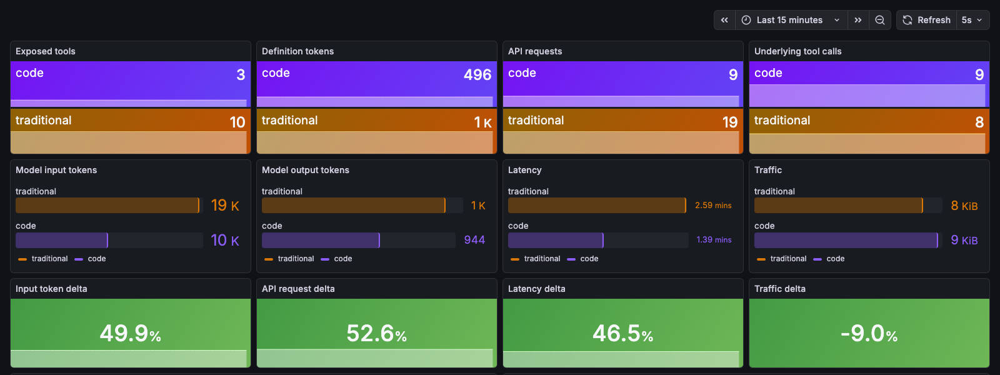
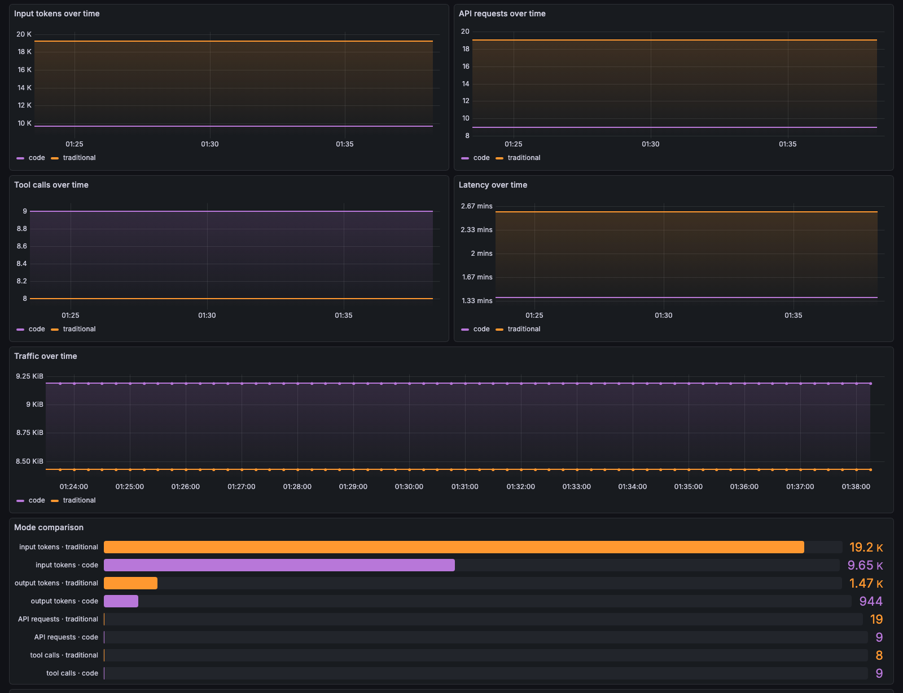

# Code Mode

Code Mode is a different way for an agent to use tools.

In the usual Model Context Protocol setup, every tool schema is placed in the model context. The model then chooses calls one at a time, and each result comes back into the conversation. That works for a handful of tools. It gets expensive and brittle as the catalog grows: the prompt fills up with definitions, intermediate data, and extra model turns.

Code Mode keeps the same tools, but changes the interface. The model sees a small programmable surface — discover a tool, read its schema, and execute code. It writes JavaScript. That code runs in a sandbox and calls the real tools from there. Search results, baggage rules, and other intermediate data stay in the sandbox instead of being copied back into the model on every step. The model returns the answer, not the whole working set.

This repository is a conference talk and a working lab for that idea: **Solving the Agent Integration Layer for Enterprise AI**.

## What this project shows

One travel task. Two executions. One NitroStack server.

| | Tool Calling | Code Mode |
| --- | --- | --- |
| What the model sees | Each travel tool as its own function | `search`, `get_schema`, and `execute` |
| Who orchestrates | The model, one call at a time | JavaScript the model writes |
| Where it runs | MCP tool handlers | NitroStack's QuickJS sandbox |
| What comes back to the model | Every tool result | The final result of the program |

The task is the same in both modes: find flights from Bengaluru to Sydney under ₹40,000 with at least 20 kg of checked baggage, and return the three cheapest options. The lab uses real MCP transports, a real OpenAI-compatible model request, and generated JavaScript. The flight inventory is deterministic sample data, so both modes can be compared on the same fixtures.

## Measured on a real Grafana dashboard

The lab exports those runs to Prometheus. Grafana charts them. Orange is Tool Calling. Purple is Code Mode.



On this run, Code Mode exposed 3 interfaces instead of 10 tools, used about half the input tokens, made 9 model requests instead of 19, and finished in 1.39 minutes instead of 2.59. Traffic — tool definitions plus tool responses sent back to the model — stayed close, at about 8 KiB and 9 KiB.



The lines stay flat between runs because each measurement is a gauge. Prometheus scrapes it every two seconds, and the value changes when the next execution finishes. Positive deltas mean Code Mode used less. The traffic delta on this run is negative: Code Mode moved slightly more data.

Open the live dashboard at [localhost:3300](http://localhost:3300) after starting the demo.

## Run

For production hosting and deployment-gated GitHub Actions, see [Vercel deployment](DEPLOYMENT.md). The hosted app supports genuine saved replay without local services or model credentials.

Requires Node.js 22.x. Run `nvm use` to select the version configured in `.nvmrc`.

```sh
npm install
npm run dev
```

Open [localhost:3000](http://localhost:3000). The deck is a fixed 1600 × 900 canvas and does not scroll. Fullscreen on a 16:9 display is the conference view.

To run the talk and the lab together:

```sh
cp .env.example .env.local   # then set the provider, model, and optional prices
npm run demo
```

- Slides: [localhost:3000](http://localhost:3000)
- Lab: [localhost:3000/demo](http://localhost:3000/demo)
- Grafana: [localhost:3300](http://localhost:3300)
- Prometheus: [localhost:9095](http://localhost:9095)

`npm run demo` builds the travel lab, starts the agent on `127.0.0.1:4100`, starts Next.js, and starts Grafana and Prometheus when Docker Desktop is running. Press `D` in the deck to open the lab. See [travel-lab/README.md](travel-lab/README.md) for the five-minute walkthrough and [observability/README.md](observability/README.md) for the dashboard lifecycle.

## Present

| Shortcut | Action |
| --- | --- |
| Right / Down / Space | Next slide |
| Left / Up | Previous slide |
| Home / End | First / last slide |
| F | Fullscreen |
| O | Slide overview |
| R | Replay the slide entrance |
| P / N | Presenter window with notes |
| T | Start or pause the timer |
| D | Open the lab |
| ? | Keyboard help |
| Escape | Close overview or help |

Open the presenter window before moving the audience window to the projector. The two windows stay in sync through BroadcastChannel. Notes stay on the presenter window. The audience window owns the timer.
